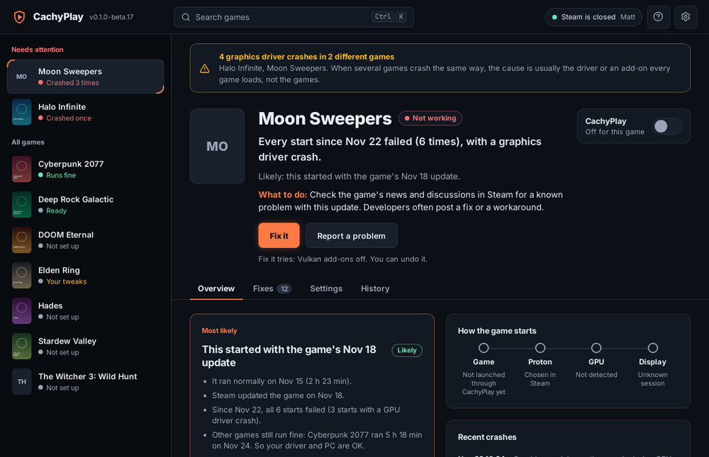

<div align="center">
  
  <h1>CachyPlay</h1>
  <p><strong>One-click Linux game tuning, crash help and timestamped bug reports for CachyOS.</strong></p>
</div>

<p align="center">
  <picture>
    <source media="(prefers-color-scheme: dark)" srcset="docs/screenshot-dark.png" />
    <source media="(prefers-color-scheme: light)" srcset="docs/screenshot-light.png" />
    
  </picture>
</p>

---

CachyPlay sits between Steam and your game. It applies known fixes for that game, shows you every change it makes, records how each launch went, and can undo everything. It never edits your system: drivers, kernels and packages are left alone.

> **Status: 0.1.0 (beta).** Desktop app, command-line tool and core engine. Fix files are examples
> until they are tested on real hardware (`tested = false`).

## Install

One command in a terminal. While the repository is private it uses the GitHub CLI, so sign in once first with `gh auth login` (CachyOS: `sudo pacman -S github-cli` if you don't have it):

```bash
gh api repos/Matt-B-007/CachyPlay/contents/install.sh -H "Accept: application/vnd.github.raw" | sh
```

That's it. It downloads the newest ready-made build from GitHub Releases, checks its checksum, installs it to `~/.local/bin` (its own location, never Downloads), adds it to your app menu and opens it. From then on CachyPlay **updates itself**: when there's a newer version, an **Update to v…** button appears at the top. Two clicks and a restart.

- For the newest beta instead of stable, put `-s -- --beta` after `sh`.
- Once the repository is public, the command becomes `curl -fsSL https://raw.githubusercontent.com/Matt-B-007/CachyPlay/main/install.sh | sh` and no GitHub sign-in is needed.
- Running it again just reinstalls; your settings stay.

**From the zip instead:** on GitHub click **Code → Download ZIP**, extract it, right-click inside the folder → **Open Terminal Here**, and run `sh install.sh`. If no ready-made build of that version is on GitHub yet, it builds CachyPlay on your PC (after asking to install the build tools with pacman). Then you can delete the folder.

Installer options: `--beta`, `--version X`, `--from-source`, `--no-launch`, `--uninstall`. The desktop app needs WebKitGTK (`webkit2gtk-4.1`), which CachyOS installs with most desktops.

## Use

Open **CachyPlay** from your app menu. Your games are on the left with a traffic light: green runs fine, yellow works with a fix (or a fix is being tested), red not working, grey not played lately. Pick a game and the top of the page tells you, in three lines, **what happened**, **why** (and how sure CachyPlay is), and **what to do**. If there's a one-click fix, press **Fix it**. The page updates by itself while it's open: when a game starts, ends or crashes, and when Steam opens or closes. Nothing is redrawn while the window is minimized or hidden (a light check every 10 seconds keeps the tray icon or crash notifications current and finishes changes that wait for Steam to close), and opening CachyPlay again just brings the open window to the front. A new install starts with a short tour; you can replay it from Help.

After a fix, a game moves through **Testing the fix → Seems to work → Works with a fix**, with the fix named. A clean run is twice as long as the game used to last before crashing (at least 10 minutes, at most an hour), and "Works with a fix" needs 3 clean runs, or 2 adding up to an hour. A new crash after the fix sends it back to red; crashes from before the fix no longer count. Every start counts, even with CachyPlay off.

- **Fixes** starts with **Applied for this game**: everything CachyPlay adds to the game's starts (which Steam's launch options don't show), each with **Undo** (it asks why, so fixes that made things worse stay crossed off for that game) and **Undo all**. Then **Find the cause**: the tests in order, with what's already ruled out (including settings you tried in Steam's launch options). Each suggestion says how sure CachyPlay is (**Likely**, **Possible** or **Long shot**), why, and what would prove it. Bigger changes, like going back to an older driver, are marked **Big step**, shown last and never done automatically.
- **Settings** (per game) starts with **Try these settings**: type settings like `VKD3D_CONFIG=no_upload_hvv` or game options like `-force-d3d12`, and CachyPlay uses them at the next start without touching Steam's launch options (so it works with Steam open and CachyPlay stays on). It also shows which Vulkan add-ons are installed and which are actually active, exactly what CachyPlay changes, **Use the graphics card** (on PCs that also have a chip built into the processor or motherboard), OBS game capture, the line to keep your settings without CachyPlay, and **Reset the game's Windows files** (plus deleting the old copies once you don't need Undo).
- **History** shows the status steps and the recent starts as a timeline: plain outcomes ("Graphics crash after 4 min", "Ran fine · 45 min", "Didn't start"), what was on for each start (fixes, Proton version, graphics chip, whether CachyPlay was on), clean-run progress, and dividers for fixes, Proton switches, driver and game updates. After a start, **What happened?** asks: ran fine, stutter, graphics glitches, crashed, or network lag, and online or offline. It has **Tell the developer**, and **Tell NVIDIA** when the same driver error keeps happening.
- **Steam open?** Fixes and your settings work right away. Turning CachyPlay on or off, switching Proton and resetting Windows files wait and happen the moment Steam closes; **Close Steam for me** does it in one click and offers to reopen Steam. If you replace CachyPlay's part of the launch options in Steam, the game page offers **Put CachyPlay back** (keeping your new options).
- When a game is broken, a card compares it with games that run fine on your PC.

At the top right: the update button (only when there's an update), **Help (?)** with Report a problem, What's new, Keyboard shortcuts, Show the tour and About, and the gear for **Settings**: General (an optional tray icon), Appearance (System / Dark / Light, big-screen mode for the TV with controller support), Updates, Privacy (optional ProtonDB ratings, the bug reports you saved), a **PC check** for common Linux gaming problems, OBS game capture, Your game settings, Advanced (self-test, restore all games) and About & uninstall. Problems the PC check finds also show as a banner.

**Keyboard:** Ctrl+K searches everything (games, fixes, settings and actions), Ctrl+, opens Settings, **?** lists the shortcuts, F1 opens Help, **/** searches games, Esc goes back, Ctrl+Q quits.

**Tray icon (optional):** turn it on in Settings › General. It's lit while a game runs, has a red badge when CachyPlay is off for the game you're playing, an amber dot while a fix is being tested, a change waits for Steam or an update is ready, a red dot after a crash, and is grey when Steam isn't found. It needs `libayatana-appindicator` (`sudo pacman -S libayatana-appindicator`). With the tray off, a crash while CachyPlay is in the background shows a desktop notification.

From a terminal: `cachyplay doctor` or `cachyplay --self-test` (PC check and self-test; `--self-test --quick` only checks CachyPlay itself starts), `cachyplay --report`, `cachyplay --update`, `cachyplay --rollback`, `cachyplay --uninstall`, `cachyplay try <appid> "SETTINGS"`, `cachyplay suggest <appid>`, `cachyplay fix <appid> <fix>`, `cachyplay reset-prefix <appid> [--undo | --delete-kept]`, `cachyplay card <appid> on|off`, `cachyplay report <appid>`.

Need help? See [SUPPORT.md](SUPPORT.md). Found a security problem? See [SECURITY.md](SECURITY.md). Making a release? See [RELEASING.md](RELEASING.md).

## How it works

`apply` adds one segment in front of `%command%` in the game's Steam launch options. Everything you had there stays where it was:

```text
before:  PROTON_LOG=1 %command% -nosplash
after:   PROTON_LOG=1 sh -c '[ -x "$0" ] && exec "$0" run -- "$@"; exec "$@"' /usr/bin/cachyplay %command% -nosplash
```

The `sh -c` part makes it **fail open**: if CachyPlay is missing or broken, the game starts exactly as it would without it. Inside the wrapper, any error or crash while preparing also falls back to launching the game unmodified.

When the game starts, CachyPlay applies the game's fix file (environment variables, game arguments, CachyOS `game-performance`). When it exits, CachyPlay records how long it ran and its exit code.

## Safety

- The original launch options are saved before the first change and never overwritten.
- `localconfig.vdf` is edited in place, changing only the one value. The file is written atomically, re-read to verify, and the last 5 versions are backed up in `~/.local/share/cachyplay/backups/`.
- Undo restores the exact original. If you edited the launch options in Steam afterwards, undo removes only CachyPlay's part and keeps your edits.
- Nothing is written while Steam is running.
- Each Steam account is handled separately.
- Flatpak Steam is detected but not supported yet; CachyPlay won't change anything there.

## Privacy

**Never collected:** CachyPlay has no telemetry, no analytics, no accounts and no ads. It never sends your game list, play times, crash details, hardware details, files or settings anywhere.

**What goes over the network, and only this:** checking GitHub Releases for app updates (no personal details; once a day, or when you press Check now, and the daily check can be turned off), and ProtonDB ratings if you turn them on (only the game's AppID).

**Bug reports** stay on your PC until you choose to share them yourself (by attaching the file to a GitHub issue or a forum post).

Before a report is written, these are replaced: your home folder (`~`, also in Windows-style paths like `Z:\home\you`), user name (`<user>`), computer name (`<host>`), Steam account IDs (`<steamid>`; game IDs stay), Steam account number and name (`<account>`, `<persona>`), IP and MAC addresses (`<ip>`, `<mac>`), and anything that looks like a token or password (`<secret>`).

Where CachyPlay keeps its files: settings in `~/.config/cachyplay`, logs and crash traces in `~/.local/state/cachyplay` (logs at most 1 MB each, 3 kept; the last 10 crash traces), downloads in `~/.cache/cachyplay`, the programs in `~/.local/bin`. Game data (fixes, what's been tried, notes) is in `~/.local/share/cachyplay`, which the family standard allows for app data.

## Suggested fixes

When a game crashes, CachyPlay works out what to try, on your PC, with no AI and no internet. It looks at:

- GPU driver errors in the kernel log, and which game was running each time
- whether **several different games** are crashing (a driver or system problem) or only one (a game problem)
- Vulkan add-ons that load into every game (frame generation, upscalers, overlays)
- recent driver upgrades, when the game last updated, and the game's own logs (Proton, Unity)

It also remembers what's been tried, including settings you put in Steam's launch options yourself (Steam's log records them), and crosses off anything that crashed anyway. While a game runs, CachyPlay records the graphics card's temperature, power and clock speeds every 2 seconds, so a bug report can say whether the card was overheating or simply waiting on stuck work.

Each suggestion lists the evidence behind it. Fixes for one game (such as turning off Vulkan add-ons for that game, or starting it in a window) are one click and can be undone. System-wide steps (rolling back a driver, resetting GPU clocks) are explained, never done automatically. After you play again, the suggestion shows whether it worked.

From the terminal: `cachyplay suggest <appid>`, `cachyplay fix <appid> <id>`, `cachyplay fix <appid> <id> --undo`.

## Updates

CachyPlay checks GitHub for a newer version when it starts, and never interrupts you. When one exists, an **Update to v…** button appears at the top and in Settings → Updates. Click it to read what's new, then **Update now**. Two clicks, then restart CachyPlay.

- **Stable or Beta:** pick a channel in Settings → Updates. Beta gets new features sooner. Beta builds follow the Beta channel until you choose; on Stable, CachyPlay tells you when a newer beta is out and offers **Switch to Beta and update**.
- **Beta and Stable together:** a beta ranks below the finished version with the same number (`0.1.0-beta.11` < `0.1.0` < `0.1.1-beta.1`). If you're on a beta that's newer than the newest Stable and switch to Stable, CachyPlay offers **Switch to Stable now**; otherwise you get Stable from its next release.
- **Updates come from GitHub Releases.** GitHub publishes one by itself whenever the version number in the code goes up and all tests pass. A release whose build failed is never offered.
- **Safe updates:** every release is signed. CachyPlay checks the signature (with either of its two built-in keys) and the SHA-256 checksum, then runs the new version's quick self-test before anything is replaced. A release without a signature isn't offered, and a tampered one is refused. The previous version is kept, so **Go back to the previous version** in Settings undoes an update.
- **If your DNS fails:** CachyPlay tries again through public DNS over HTTPS (1.1.1.1, then 9.9.9.9) before saying GitHub can't be reached.
- **AUR installs** are updated by pacman. The app shows the command (`paru -S cachyplay`, or `paru -S cachyplay-beta` for the beta channel).
- From the terminal: `cachyplay update`, `cachyplay update --check`, `cachyplay update --to-stable`, `cachyplay channel beta`.

While the GitHub repository is private, updates only work if the GitHub CLI (`gh`) is installed and signed in.

## OBS game capture

To record just the game in OBS instead of your whole desktop, games need to start through `obs-gamecapture` (the same as putting `obs-gamecapture %command%` in Steam's launch options). CachyPlay does that for you:

1. Install it once: `sudo pacman -S --needed obs-vkcapture lib32-obs-vkcapture`.
2. In CachyPlay, open the game → **Settings** tab → turn on **OBS game capture**. Or turn it on for every game in Settings → OBS game capture.
3. In OBS, add a **Game Capture** source, then start the game from Steam.

From the terminal: `cachyplay obs 1240440 on`, `cachyplay obs all on`. If `obs-gamecapture` isn't installed, games still start normally. It's kept when you uninstall with "Keep the settings". On NVIDIA, capture needs `nvidia-drm.modeset=1`, which current NVIDIA drivers on CachyOS turn on by default.

## Bug reports

**Report a problem** (on a game, or in Help for a general report) asks for a short summary and what happened, and shows a preview of what's included. Then: **Save to file**, **Copy report** or **Open log folder**. To send it, **Open on GitHub** fills in an issue with your summary and the system details and asks you to attach the saved file; there are also **NVIDIA forum** and the game's **Steam discussions** when they fit. Reports are saved to your Desktop as `cachyplay-bug-…-YYYY-MM-DD_HH-MM-SS.zip` and listed in Settings › Privacy. Every report starts with the app, version, channel, install type, distro, desktop, Wayland/X11 and kernel. Every error message, and the "closed unexpectedly" notice, has a **Report** button.

## Uninstall

```bash
cachyplay uninstall --keep-settings   # keeps working game settings in Steam, then removes CachyPlay
sudo pacman -Rns cachyplay     # only if you installed from the AUR
```

**Keep what works:** with `--keep-settings` (on by default in the app), each game's working settings, such as a fix you applied, are written straight into its Steam launch options before CachyPlay is removed, so the game keeps running the same way. A copy goes to `CachyPlay game settings.txt` on your Desktop. You can see and copy every game's settings any time in Settings → Your game settings, or with `cachyplay settings`.

CachyPlay's settings and logs are kept unless you pass `--delete-settings` (in the app: **Also delete my settings and logs**, off by default), so a reinstall picks up where you left off. Save and config backups are kept unless you pass `--remove-backups`. Bug reports on your Desktop are never deleted. You can also uninstall from the app: Settings → About & uninstall → **Uninstall CachyPlay…**

To remove every trace by hand, close Steam, run `cachyplay uninstall` first (it puts your games back), then:

```bash
rm -f ~/.local/bin/cachyplay ~/.local/bin/cachyplay-gui
rm -f ~/.local/share/applications/io.github.matt-b-007.cachyplay.desktop ~/.local/share/applications/cachyplay-gui.desktop
rm -f ~/.local/share/icons/hicolor/*/apps/io.github.matt-b-007.cachyplay.* ~/.local/share/icons/hicolor/*/apps/cachyplay.*
rm -rf ~/.local/share/cachyplay ~/.local/state/cachyplay ~/.cache/cachyplay ~/.config/cachyplay
```

## Verify on a real system before release

Things CI can't test. Confirmed on a real CachyOS + Steam PC so far:

- **Steam runs launch options through a shell** (launch records appear in `~/.local/state/cachyplay/launches/`).
- **Steam's `console_log.txt` names the game** ("Game process added : AppID …" lines), so bug reports and the Proton history know which game crashed.
- **Fail open**: games start normally when CachyPlay is missing.

Still to check once per release on a real PC:

1. **Turning off Vulkan add-ons reaches the game.** Apply "Turn off the extra Vulkan add-ons" to a game, start it with MangoHud or a frame-generation layer that's normally on, and confirm it's gone. This checks that `VK_LOADER_LAYERS_DISABLE` passes through Steam's runtime container.
2. **Use the graphics card** (PCs with a built-in chip too). Start a game, then check its History tab: the start should say "On NVIDIA graphics card" (or AMD). This checks that the settings pass through Steam's runtime and that CachyPlay can see which chip the game opened.
3. **Steam keeps the edit.** Apply with Steam closed, open Steam, and confirm the launch options in the game's Properties match.
4. **Update and Switch to Stable now** work from the app with the new release.
5. **Window icon.** After updating, the title bar and taskbar show the CachyPlay icon, not KDE's white "W".
6. **Close Steam for me** quits Steam, the waiting change happens, and **Open Steam** starts it again.
7. **Try these settings** reach the game: set `DXVK_HUD=fps` for a DirectX 11 game and check the counter appears.
8. **The GPU log** appears in a bug report after a start (NVIDIA through `nvidia-smi`; AMD through the kernel's sensor files).

## Build from source

```bash
sudo pacman -S --needed rust webkit2gtk-4.1   # build dependencies on CachyOS / Arch
cargo test --workspace
cargo build --workspace --release             # target/release/cachyplay and cachyplay-gui
```

| Crate | What it is |
| --- | --- |
| `crates/cachyplay-core` | All logic: Steam files, snapshots, fix files, launch wrapper, bug reports |
| `crates/cachyplay` | Command-line tool and the launch wrapper Steam calls |
| `crates/cachyplay-gui` | Desktop app (Tauri 2, plain HTML/CSS/JS in `ui/`) |

**Releasing:** bump `version` in `Cargo.toml` and push to `main`. GitHub runs the tests and, if they pass, tags and publishes the release by itself. See [RELEASING.md](RELEASING.md).

The desktop app is a separate program on purpose: the launch wrapper runs before every game, so it stays small and starts instantly without loading WebKit.

## Roadmap

| Version | Focus |
| --- | --- |
| **v0.1.0** | Desktop app, command-line tool, core engine; 5 tested fix files |
| v0.2.0 | Signed fix-file updates, one-click crash fixes, Proton manager, save backups |
| v0.3.0 | Hardware-aware fixes, driver-vs-game crash triage, pre-flight checks |
| v1.0.0 | Heroic and Lutris, gamepad navigation, Gamescope and upscaler options |

## License

MIT. See [LICENSE](LICENSE). The bundled Manrope font is under the SIL Open Font License (`crates/cachyplay-gui/ui/fonts/OFL-Manrope.txt`).
